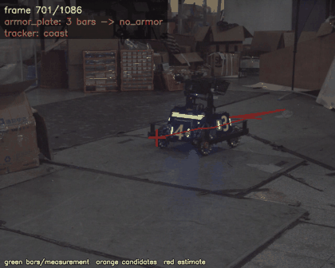
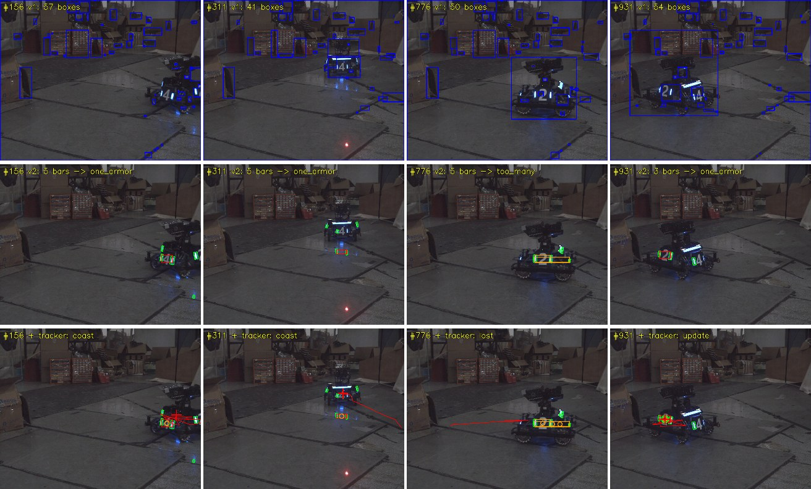
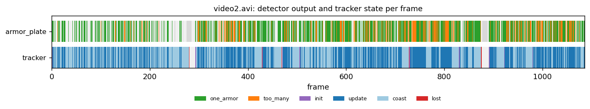
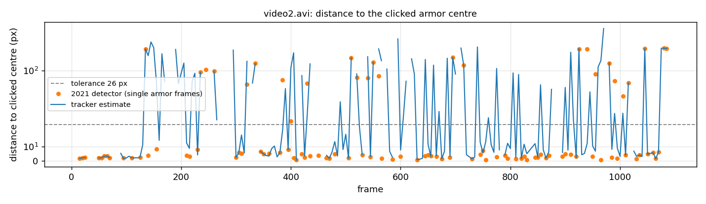
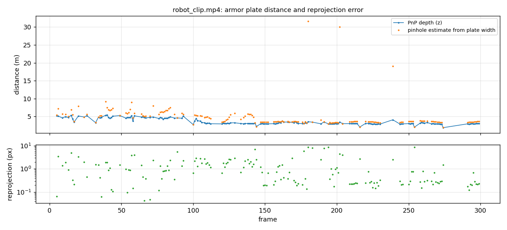
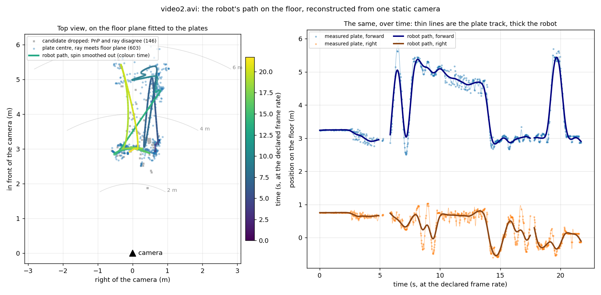

# Finding a robot in video: detection, tracking, pose, and how far off each one is

This repository finds the opponent robot in footage from a RoboMaster team camera, tracks it between frames,
and recovers its position in millimetres — and then measures how well each of those steps actually works
against frames labelled by hand. The detector started as two attempts written in C++ for the vision team of
HITCRT at Harbin Institute of Technology: the first did not work, the second did, and neither came with any way
of saying how well. Both are kept unchanged, with a test harness built around them.



*The team camera's recording (1280×1024, 50 fps). Green: light bars found by the detector. Red: the tracker's
position estimate, with its recent path.*

## In one minute

| | |
|---|---|
| **Attempt 1** — grayscale threshold | never finds the robot: 52 boxes per frame, one covering the whole image in every frame |
| **Attempt 2** — colour + light-bar geometry | reports a target in 48.3% of frames; **82.5% of those are correct** (median error 3.3 px) |
| **The tracker** — Kalman filter, gating, association | a correct position in **56.4%** of frames with a target, up from 40.3% |
| **The robot on the floor** — floor plane fitted to the plates, ray–plane intersection, Kalman + RTS smoother | its path in metres over the whole recording; the right plate in **69.2%** of labelled target frames, against 56.4% in the image plane |
| **A second camera** — calibrated from scratch, checked against a ruler | distance correct to **0.13%** between 0.3 m and 1.2 m ([`dashcam_metrology/`](dashcam_metrology)) |
| **The point** | before labelling I thought the tracker covered 96.9% of frames. 218 hand-labelled frames showed half of those positions were wrong, and I re-tuned against the labels instead of the coverage number. |

Read [what 218 labelled frames changed](#what-218-labelled-frames-changed) for that part,
[the robot's path on the floor](#from-one-plate-per-frame-to-the-robots-path-on-the-floor) for the top view, or
[running it](#running-it) to try it on your own video. The original C++ is in
[`original_2021/`](original_2021), unchanged. A second camera, calibrated from scratch and checked against a
ruler, is in [`dashcam_metrology/`](dashcam_metrology).

## Attempt 1: the robot is the bright thing (wrong)

[`original_2021/carcarcar.cpp`](original_2021/carcarcar.cpp) converts the frame to grayscale, blurs it three
times, thresholds at a fixed value of 40, and draws the bounding box of every contour.

It never isolates the robot. On the original footage the threshold turns most of the image white, so the
contours it finds are the dark floor joints and shadows: a median of 52 boxes per frame, and in **every single
frame** one box covering the whole image. The idea that the target is simply "brighter than the rest" does not
survive contact with a real gym floor under stage lighting.

## Attempt 2: the robot is the blue thing, twice (right)

Competition robots carry two vertical LED light bars beside each armor plate, in the team colour. That is a
much stronger signal than brightness, and a pair of them is a distinctive geometric pattern.

[`original_2021/armor_plate/`](original_2021/armor_plate) subtracts the red channel from the blue one,
thresholds at 0.65 × the maximum value of that difference image and dilates. Contours are then filtered into
light-bar candidates by their ellipse angle and the aspect ratio of their minimum-area rectangle, and candidates
are paired into armor plates by four cascaded rules on angle difference, height difference, width difference
and vertical offset.



*The same four frames through all three stages. Top: attempt 1. Middle: attempt 2 — green light bars, red box
when exactly one armor plate is found, orange when several are. Bottom: attempt 2 plus the tracker.*

## What the program could not tell me

The C++ prints `no armors!` or `too many armors!` and moves on, giving no indication of how often that
happens. Measured over all 1086 frames of the recording:

| Detector output | Share of frames |
|---|---|
| exactly one armor plate (a usable target) | **48.3%** |
| several candidates, program gives up | 18.5% |
| light bars found, none pair up | 30.5% |
| fewer than two light bars | 2.7% |



So the detector that felt like it "worked" produces a target in about half the frames. The gaps are mostly
short — 248 of them, a median of 1 frame, 90% shorter than 5 frames, the longest 28 frames (0.6 s) — which is
the signature of a per-frame detector flickering on a target that is still plainly there. A turret driven
directly by this signal would stutter constantly, and the fix is not a better threshold but remembering the
target between frames.

## Turning intermittent detections into a continuous track

Detection per frame is the wrong abstraction — the robot does not disappear when a light bar does. So I added
what the original lacked: a constant-velocity Kalman filter on the armor centre
([`replay/tracking.py`](replay/tracking.py)). Each frame it predicts the next position, accepts the candidate
closest to that prediction if it falls inside a χ² gate, coasts when nothing matches, and drops the track after
a few coasting frames. This is the predict / gate / associate structure used by the team's later tracking code,
in a minimal 2-D form.

With that in place the share of frames holding *some* position jumped from 48.3% to 96.9% with my first
settings, and that is where I stopped the first time. It was the wrong place to stop. With the settings the
labels later forced (below), the same figure is 83.5%: a position in 51.1% of frames from a real measurement,
32.4% coasting, and 98 short tracks over 1086 frames instead of 5 long ones.

## What 218 labelled frames changed

Every number above counts outputs, not correct outputs. So I clicked the armor centre on every 5th frame of the
recording with [`label_frames.py`](label_frames.py): 218 frames, 211 of them with a visible target, 228 plates
in total because 17 frames show two plates at once. [`evaluate.py`](evaluate.py) scores a position as correct
when it lands within 2% of the frame width (25.6 px, roughly half an armor plate) of any plate clicked in that
frame.

| | correct when it reports | of all frames with a target | median error |
|---|---|---|---|
| Detector, frames where it reports one plate | **82.5%** (85/103) | 40.3% | **3.3 px** |
| tracker, tuned (see below) | 66.9% (119/178) | **56.4%** | 6.8 px |
| ‣ on frames where it used a measurement | | | 4.8 px |
| ‣ on frames where it was coasting | | | **67.0 px** |



*Each orange dot is a frame where the detector reported a single plate; the blue line is the tracker.
Below the dashed line counts as correct. The detector is either right to within a few pixels or wrong by more
than 100 — there is very little in between.*

Three things came out of this that no coverage metric could have told me:

**The detector is accurate when it speaks.** Within 3.3 px of where I clicked, four times out of five. Its
problem was never precision, it was that it only speaks in 40% of the frames that have a target.

**The pairing rules, not the threshold, are the bottleneck.** In 59.2% of frames with a target, a correct plate
was among the candidates, but the four cascaded pairing rules either dropped it or reported several and gave
up. That is the upper bound any re-tuning of those rules could reach, and it is where I would work next.

**My headline tracking number was measuring the wrong thing.** Before labelling, the tracker with its original
settings covered 96.9% of frames and I was pleased with it. Against the labels, only 49.8% of target frames got
a *correct* position, its coasting estimates were off by a median of 96 px — four times the tolerance — and on
frames with no target at all it still held a position 57% of the time. Coverage had rewarded exactly the
behaviour that was hurting it.

### Re-tuning on the labels

[`tune_tracker.py`](tune_tracker.py) detects the video once and then scores 25 combinations of gate width and
coasting patience on the cached detections:

| gate σ (px) | coasting frames | correct, of target frames | precision | error while measuring | error while coasting | position on empty frames |
|---|---|---|---|---|---|---|
| 10 | 2 (new default) | **56.4%** | 67.6% | 4.1 px | 66.4 px | 28.6% |
| 10 | 0 (never coast) | 47.9% | **77.7%** | 4.9 px | — | **0.0%** |
| 25 | 15 (old default) | 49.8% | 51.0% | 14.4 px | 95.9 px | 57.1% |
| 50 | 15 | 38.9% | 39.8% | 27.5 px | 67.4 px | 42.9% |

Coasting buys coverage and pays for it in precision: every extra coasting frame adds positions that are mostly
wrong. The defaults are now a gate of 0.8% of the frame width and 2 coasting frames. If a wrong position is
worse than no position — which it is for a turret — never coasting is the better setting, and the tool makes
that trade-off visible instead of hiding it behind one number.

This tuning used 211 labelled frames of one video, so a few percent is a handful of frames. It is enough to
rank "coast for 15 frames" against "coast for 2", not enough to claim 10 px is better than 12.

### Two ways these accuracies flatter the algorithms

A position counts as correct when it is near **any** plate labelled in that frame, so the score does not check
that the algorithm picked the plate a turret should actually engage: with two robots in view, hitting either
one counts.

And the second plates were added in a second pass over the frames where a reported position had missed, which
is exactly where extra labels can turn a miss into a hit; frames the algorithms already got right were not
re-checked. Adding labels can only raise these numbers, never lower them. The unbiased procedure is to label
every visible plate in a random subset from the start, which is what I would do with more labelling time.

## Replacing the pairing rules with two small models

The labels pointed at the pairing rules, so that is where the first learned component goes
([`replay/learned.py`](replay/learned.py)). Every pair of light bars in a frame is scored by two models instead
of the four cascaded rules:

- a **pair classifier**, an MLP with two hidden layers on ten scale-free measurements of the two bars (spacing,
  offsets, length and width ratios, tilts, all divided by the bar length), which says whether the two bars could
  belong to one plate;
- a **number classifier**, a three-layer CNN on the 32×32 patch between the bars, straightened by a perspective
  warp ([`replay/armor_patch.py`](replay/armor_patch.py)), which reads the number printed on the plate or says
  there is no plate.

A pair is kept when both agree, plates claim their bars best first so no bar is used twice, and the detector
reports the best plate instead of giving up when it sees several. Both models are exported to ONNX and run
through `cv2.dnn`, so using them needs nothing beyond OpenCV (under 1 ms per frame on the clip, on a CPU), and
the same files load in OpenCV's C++ API, OpenVINO or TensorRT. PyTorch is only needed to train them.

The training data comes from the labels that already exist. A pair whose centre is far from every clicked plate
is a negative; a pair near a click is a plate, and [`label_patches.py`](label_patches.py) asks for the number on
it. On the committed clip that is 465 pairs: 406 negatives, and 73 pairs near a click, of which 14 turned out
not to be one plate (bars of two different plates, a plate seen edge-on) and 59 show a 2, 3 or 4. I labelled
those 73 patches by eye ([`labels/robot_clip.patches.csv`](labels/robot_clip.patches.csv)).

Scored with cross-validation in time, five contiguous blocks of the clip, each scored by models trained on the
other four (`python train_armor_models.py clips/robot_clip.mp4`):

| on the clip, 56 labelled frames with a target | 2021 rules | learned, held out |
|---|---|---|
| detector reports a plate, correct | 89.7% (26/29) | **93.9%** (46/49) |
| ‣ of all frames with a target | 46.4% | **82.1%** |
| tracker, correct, of all frames with a target | 58.9% | 73.2% |
| detector median error (p90) | 3.8 px (24.8 px) | 3.5 px (**6.8 px**) |
| number on the plate, hand-labelled plates | — | 58/59 |
| false target on the 4 empty frames | 0% | 0% |

The detector now reports a correct plate in most frames instead of fewer than half, without losing precision.
The tracker gains less, and is now the weaker stage: it still starts a track only from a frame with exactly one
candidate and was tuned for the old detector, so re-running `tune_tracker.py` with the new candidates is the
obvious next step. With another seed the held-out numbers are 82.1% and 78.6%; the detector figure is stable,
the tracker figure moves by a few frames.

What this does not show: it is one six-second clip of one robot, the folds are neighbouring stretches of that
same clip, and the number classifier has only seen 2, 3 and 4. The committed models in `models/` are trained on
all of it, so `python evaluate.py clips/robot_clip.mp4 --matcher learned` scores what they memorised and says
so; the held-out numbers come only from `train_armor_models.py`. The full 1086-frame recording and other footage
are what should train and test the next version:

```bash
pip install -r requirements-ml.txt                       # PyTorch and ONNX, for training only
python label_patches.py video2.avi                       # the number on each pair near a click
python train_armor_models.py video2.avi clips/robot_clip.mp4 --cv 5   # compare, then write models/
python evaluate.py video2.avi --matcher learned          # or run_videos.py ... --matcher learned
```

## The pose solver

The C++ has one more stage, `display()`: turn the plate in the image into a position in metres, so the turret
knows where to aim. It never compiled. The recording is 1280×1024 and the calibration numbers kept alongside
the original code are for exactly that camera, so the stage can be completed: [`replay/pose.py`](replay/pose.py) takes the four light-bar endpoints as the plate corners,
the plate size in millimetres, the intrinsics and distortion, and calls `cv2.solvePnP`.

```bash
python solve_pose.py clips/robot_clip.mp4
```



On the committed clip it solves 165 of 300 frames: a median distance of **3.12 m** (range 1.87–5.45 m) with a
median **reprojection error of 0.72 px**. There is no ground-truth distance for this footage, so instead of
claiming an accuracy the tool reports two self-checks:

- **Reprojection error** — project the solved plate back into the image and compare with the corners it came
  from. A wrong corner order or wrong intrinsics shows up here immediately.
- **An independent pinhole estimate** `d = fx · W / w_px` from the apparent width. It agrees with PnP when the
  plate faces the camera (ratio 1.02 at the 10th percentile) and reads *further* when the plate turns away and
  looks narrower — the orange spikes in the figure. That is the expected disagreement, and seeing it is how I
  know both are behaving.

The plate is a standard small armor plate, 135 × 55 mm ([`config/armor_plates.json`](config/armor_plates.json)).
Armor plates are standardised competition parts, so that size holds on every robot, and it is what turns pixels
into millimetres here. One caveat: the intrinsics belong to the full-size frame. If frames are downscaled the
camera matrix has to be scaled with them, which is a test in [`tests/test_pose.py`](tests/test_pose.py)
precisely because it is such an easy mistake — at `--proc-width 720` the same clip reads 2.88 m instead of
3.12 m, the rest of that gap coming from coarser light-bar endpoints after the resize. Run at native resolution when the numbers matter.

## From one plate per frame to the robot's path on the floor

The pose solver answers "where is this plate, relative to the camera, in this frame". What a turret, a referee
system or a planner wants is the next question: where is the robot on the floor, and how is it moving.
[`reconstruct_trajectory.py`](reconstruct_trajectory.py) answers it for the full recording, with no marker,
survey or second camera — only the calibration and the footage.

```bash
python reconstruct_trajectory.py video2.avi
```



*Left: top view in metres. Blue dots are plate centres placed on the floor, the coloured line is the robot's
path. Right: the same over time — the thin lines oscillate as the robot spins, the thick ones are its
translation. The robot waits at 3.2 m for three seconds, then charges out to 5 m and back several times.*

It takes four steps ([`replay/trajectory.py`](replay/trajectory.py)):

**1. The floor, from the robot itself.** The camera did not move during the recording (the image shifts by a
median of 0.2 px per ten frames), and the robot drives on a flat floor, so every plate centre sits at the same
height. A robust plane fit through the PnP positions gives that plane: the camera is **0.62 m above the plates,
pitched 9.7° down**, with the plates within 32 mm of the plane. DeepScenario's GroundMix fits its ground plane
from object ground centres in the same spirit.

**2. Position from the ray, not from PnP depth.** PnP depth comes from how large the plate looks, and here the
plate is 50–100 px wide. When it turns, its width foreshortens, and planar PnP returns two mirror solutions
whose reprojection errors differ by a median factor of only 1.17, so it cannot tell which way it turned. Once
the floor is known, the pixel alone fixes the position: the ray through the plate centre meets the plane once.
With the camera 0.62 m above the plates, a pixel of vertical error moves that point by about a centimetre at
4 m. This is the step the DSC3D pipeline takes when it replaces the detector's depth with the intersection of a
ray and the reconstructed ground.

That leaves two independent ranges for every candidate, one from the plate's size and one from the plane, and
they make a filter: PnP scatters about the ray by a robust 0.3 m at 3 m and 0.6 m at 4.5 m, and the 146 of 1001
candidates that disagree by more than three times that are dropped. Their average agreement (a ratio of
1.003) is built in, because the plane was fitted to the PnP positions; what the comparison catches is the
individual candidate that does not fit.

**3. Filter forward, smooth backward.** A constant-velocity Kalman filter on the floor associates the
candidates of each frame, with a measurement covariance that is long along the line of sight and narrow across
it, as the geometry dictates. A Rauch–Tung–Striebel pass then smooths each track with the frames after as well
as before, which fills detection gaps from both sides. The mean normalised innovation is 1.42 against 2.0 for a
perfectly calibrated noise model, so the model is, if anything, slightly pessimistic.

**4. The robot, not the plate.** The robot in this recording is spinning: a different numbered plate faces the
camera every few frames, so the measured plate circles the chassis. A second, physically slow filter over the
plate track treats that circling as noise and keeps the translation — the thick lines in the figure. It covers
1022 of 1086 frames.

### How well it works

Against the same 211 hand-labelled frames and the same tolerance as the image-plane tracker above — the 3-D
track is projected back into the image and compared with the clicked plate:

| | correct, of frames with a target | error on frames without a measurement |
|---|---|---|
| Image-plane tracker (tuned, above) | 56.4% | 67.0 px median, coasting |
| Floor tracker, forward filter only | 68.2% | 60.6 px median |
| **Floor tracker, smoothed** | **69.2%** | **33.5 px** median |

The forward filter is causal, like the image-plane tracker, and it already does better; a likely reason is that
on the floor, a candidate a few pixels away in the image but a metre away in depth is no longer a plausible
match. The smoother halves the error in the gaps.

A second check needs no labels: hide one block of frames in every three, rebuild the track from the rest, and
compare the hidden frames with their own measurements.

| hidden block | smoothed, median (p90) | forward filter, median (p90) |
|---|---|---|
| 2 frames | 91 mm (382 mm) | 176 mm (814 mm) |
| 5 frames | 111 mm (396 mm) | 187 mm (760 mm) |
| 10 frames | 180 mm (391 mm) | 414 mm (1490 mm) |

### What these numbers cannot show

- **The label check is blind to depth.** It tests where the plate lands in the image, and an error along the
  line of sight — the direction with the largest uncertainty — barely moves it there. The hold-out check covers
  that direction, but it scores the method against its own measurements, so it measures how well gaps are
  filled, not how right the metres are.
- **The scale comes from the plate size.** The plane's height comes from the PnP positions, so the
  competition's 135 mm plate width sets the scale of the whole floor. Fitted on the six-second clip alone, the
  plane comes out at 0.53 m and 8.0° instead of 0.62 m and 9.7°: the estimate depends on which plates it gets
  to see.
- **The robot path sits towards the camera.** Only camera-facing plates are visible, so the path is offset from
  the chassis centre by up to a chassis radius. Fitting circles to the plate arcs would locate the centre, but
  on this footage free-radius fits converge in only half of the windows, so I did not use them.
- **Speeds use the frame rate written in the file.** At the declared 50 fps the robot path has a median speed
  of 0.38 m/s and a 95th percentile of 3.9 m/s. The recorder's real frame timing was not kept, and the
  dash-camera work below is a reminder of why a declared rate is not a measured one.
- **The tracker settings were chosen on the same labels.** A sweep over 96 combinations found a broad
  plateau of process noise between 100 and 400 m/s² (large, because the visible plate jumps as the robot
  spins); the default is the middle of that plateau, not its best point.

## Checking the millimetres against a ruler

The pose solver above returns millimetres, and the section it sits in has to admit that nothing in this footage
can say whether those millimetres are right — the checks are for self-consistency, not accuracy. Footage cannot
be re-measured after the fact.

So the same question is asked of a camera a ruler can reach. [`dashcam_metrology/`](dashcam_metrology)
calibrates a cheap dash camera from scratch, picks its lens model by measuring whether the checkerboard's own
rows and columns come out straight after undistortion rather than by reprojection error, and compares the
distances it produces against a marker stepped back one A4 sheet at a time.

| | |
|---|---|
| Intrinsics | 36 frames, RMS reprojection **0.398 px**, field of view 86.6° × 55.9° |
| Undistortion | largest deviation from a straight line drops from 0.689 px to **0.327 px** across 520 lines |
| Distance | scale correct to **0.13%** between 0.3 m and 1.2 m, 6 mm of residual about a straight line |
| The marker size it rests on | reached twice, once optically and once with a ruler, agreeing to **0.21 mm** |

Both cameras run through the same pose code: `dashcam_metrology/config/camera_dashcam.json` uses the schema
`replay/pose.py` already reads. Three mistakes made on the way there, none of them visible in the output, are
written up in that folder's README along with what the numbers cannot show.

## Honest boundaries

- The stage-1 and stage-2 algorithms are the original C++, kept unchanged under `original_2021/` (tag
  `original-2021`). `carcarcar.cpp` is a scratch file from the same period: besides my own attempt it holds a copy of
  OpenCV's `groupRectangles` implementation, which I had pasted in while trying the cascade face detector and
  reading how it merges overlapping boxes. That block is OpenCV's code and stays under OpenCV's licence; the
  rest of the file, including the calibration numbers, is mine.
- The measurements come from a **Python replay** of that C++ code, not from running the C++ binary. The replay
  uses the same OpenCV calls, parameters and branch conditions; each deviation is marked `NOTE` in
  [`replay/pipelines.py`](replay/pipelines.py). The machine it ran on (Ubuntu, OpenCV built from source) no
  longer exists.
- The C++ `display()` function was never finished and does not compile. Its pose part is reimplemented in
  `replay/pose.py` rather than replayed; the ballistics part is not implemented at all.
- **The ground truth is 218 frames of one video, clicked by me**, every 5th frame, 228 plates. The accuracy
  figures inherit that: a single scene, my own idea of where the centre of a plate is, a tolerance I chose, and
  the two biases described above. The frame-level percentages in the earlier sections (how often a stage
  produces any output) cover all 1086 frames.
- The first version of the labelling tool divided the click coordinates by the display scale, which OpenCV had
  already applied. Every label was 14% too far from the origin and the first evaluation scored 0/103 correct.
  The clicks were recoverable by scaling them back; the original file is kept as
  `labels/video2.buggy-coordinates.csv.bak`. A test now pins the label round trip.
- The tracker, the harness, the calibration work, the tests and this README are later additions, written with
  help from an AI coding assistant. All numbers come from the scripts in this repository.

## Robustness on other footage

Five phone recordings of robots (1080×1920, not included here) give 12–38% single-armor frames and 57–96%
tracked frames, with the light-bar colour detected automatically. Two things break on them: the pixel
thresholds of the detector assume the team camera, so frames have to be downscaled to roughly 720 px
wide (`--proc-width`), and in a scene with both a blue and a red robot the automatic colour choice is
meaningless and has to be set by hand.

## Ground truth: labelling and scoring

Everything above counts *outputs*, not *correct outputs*. [`label_frames.py`](label_frames.py) is a click tool
for building the missing ground truth, and [`evaluate.py`](evaluate.py) scores both stages against it.

```bash
python label_frames.py video2.avi --every 5   # click the armor centre on every 5th frame
python evaluate.py video2.avi                 # score the detector and the tracker
```

In the labelling window: **left click** marks the armor plate the turret should aim at, **x** marks a frame
with no visible target, **n** skips, **b** goes back, **u** clears the frame and **q** saves and quits. Labels
go to `labels/<video>.csv` after every click, so the work survives a crash and the tool resumes at the first
unlabelled frame.

`evaluate.py` then replays the video and reports, for the labelled frames:

- how often the detector's single-armor output is within tolerance of the clicked centre — its precision,
  and its share of all frames that had a target;
- the same for the tracker, split into frames where it used a measurement and frames where it was coasting;
- how often the right pair was among the candidates but the pairing rules dropped it (an upper bound on what
  better pairing rules could reach);
- how often a target is reported on frames labelled as empty;
- median and 90th-percentile error in pixels, plus an error-over-time plot.

The default tolerance is 2% of the frame width (25.6 px at 1280), roughly half an armor plate at mid distance;
`--tol-px` overrides it. Scoring logic is unit-tested in [`tests/test_metrics.py`](tests/test_metrics.py).

A frame can show more than one armor plate, and a label that only marks one of them scores the detector wrong
when it picks the other. `evaluate.py` therefore writes the frames where a reported position missed every label
to `disputed_frames.txt`, so they can be re-checked without going through the whole video again:

```bash
python label_frames.py video2.avi --frames-file outputs/video2/disputed_frames.txt
python tune_tracker.py video2.avi     # re-tune once the labels change
```

## Running it

A six-second cut of the original recording is committed at `clips/robot_clip.mp4` (300 frames, 1280×1024,
untouched apart from the re-encoding), together with the labels for those frames, so everything below runs
after a clone:

```bash
pip install -r requirements.txt
python -m pytest                                 # 50 tests on synthetic data
python run_videos.py clips/robot_clip.mp4        # plays it back with the detections drawn on
python evaluate.py clips/robot_clip.mp4          # scores both stages against the labels
python tune_tracker.py clips/robot_clip.mp4      # the gate/patience sweep, on the clip
python solve_pose.py clips/robot_clip.mp4        # plate distance from PnP, with its self-checks
python reconstruct_trajectory.py clips/robot_clip.mp4   # the robot's path on the floor, checked against the labels
```

On the clip the detector is right in 26 of the 29 frames where it reports a plate. The numbers quoted in this
README come from the full 1086-frame recording, which is 105 MB and not committed; `--proc-width 0` keeps the
native resolution the thresholds were written for.

```bash
python run_videos.py                               # every video in this folder, played back in a window
python make_figures.py video2.avi --proc-width 0   # rebuild the figures above, from the full recording
```

Each video is played back with the detections drawn on it and written to `outputs/<name>/annotated.mp4`;
**space** pauses, **n** skips, **q** quits, **s** saves a frame. Each run also writes `summary.json`, per-frame
`frames.csv`, contact sheets per stage and a trajectory plot.

| Option | Meaning |
|---|---|
| `--enemy auto\|blue\|red` | Light-bar colour; `auto` probes both on ~30 frames. |
| `--proc-width 720` | Downscale before detection (`0` = native). The thresholds assume light bars of 10–150 px. |
| `--meas-std`, `--max-coast`, `--accel-std` | Tracker gate, patience and process noise. |
| `--no-show`, `--no-video`, `--speed` | Batch mode, skip the mp4, playback speed. |

## Repository layout

| Path | What it is |
|---|---|
| [`original_2021/`](original_2021) | The original C++, unchanged. |
| [`replay/pipelines.py`](replay/pipelines.py) | Python replay of both C++ programs. |
| [`replay/tracking.py`](replay/tracking.py) | The Kalman tracker. |
| [`replay/visualize.py`](replay/visualize.py) | Overlays, contact sheets, plots. |
| [`run_videos.py`](run_videos.py) | Playback and evaluation over one or more videos. |
| [`make_figures.py`](make_figures.py) | Builds the figures in this README. |
| [`label_frames.py`](label_frames.py) | Click tool for ground-truth armor centres. |
| [`evaluate.py`](evaluate.py) | Scores detector and tracker against those labels. |
| [`replay/metrics.py`](replay/metrics.py) | The scoring itself, unit-tested. |
| [`tests/`](tests) | Unit tests on synthetic data: detection, colour selection, pairing rules, tracker gating, scoring, pose, floor plane, ray intersection, smoother, end-to-end trajectory. |
| [`clips/`](clips), [`labels/`](labels) | A six-second cut of the original recording and the frames I labelled by hand. |
| [`solve_pose.py`](solve_pose.py), [`replay/pose.py`](replay/pose.py) | The plate pose: PnP and its self-checks, completing the unfinished `display()`. |
| [`reconstruct_trajectory.py`](reconstruct_trajectory.py), [`replay/trajectory.py`](replay/trajectory.py) | Floor plane from the plates, ray–plane positions, floor Kalman filter, RTS smoother, robot path. |
| [`config/`](config) | The team camera's calibration and the armor plate dimensions, both as data rather than constants. |
| [`dashcam_metrology/`](dashcam_metrology) | A second camera calibrated from scratch, with its distances checked against a ruler. |
